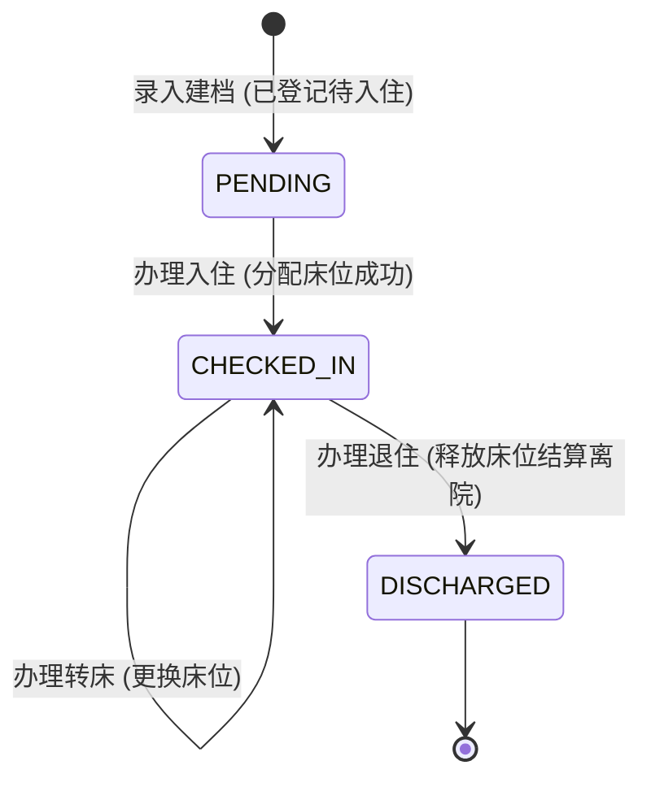
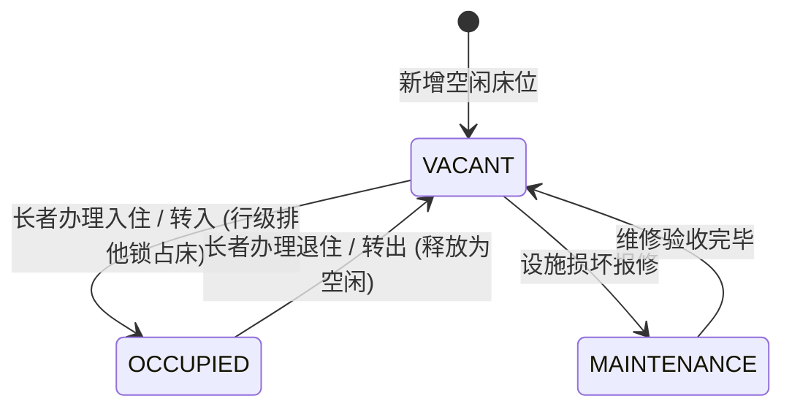
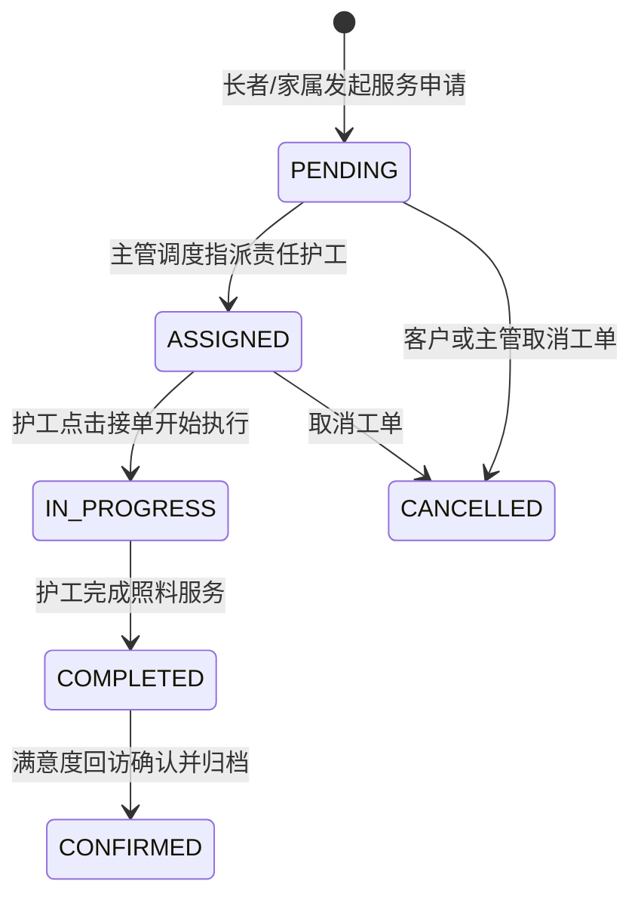
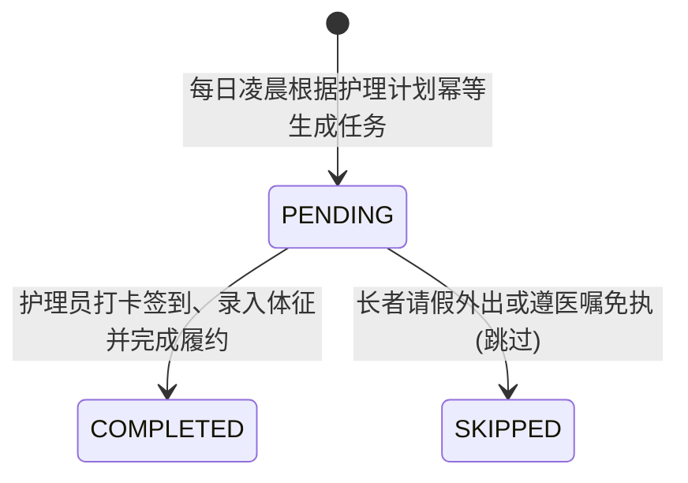
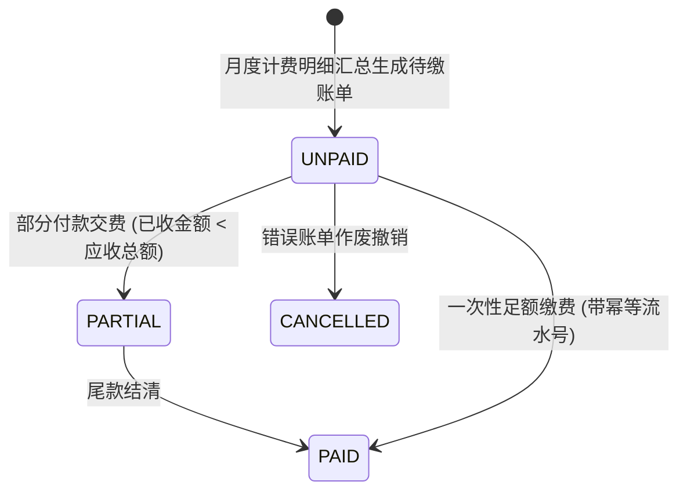
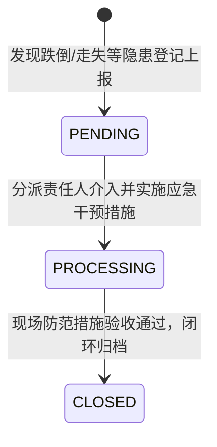
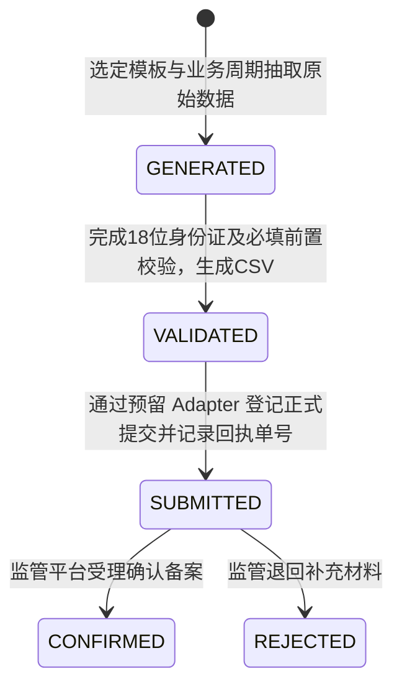

# 智慧养老综合运营管理系统 - API 接口与业务状态机设计规范

## 一、通用接口响应协议

所有 RESTful API 均采用统一的 JSON 报文封装结构：

```json
{
  "code": 0,
  "message": "success",
  "data": { ... },
  "timestamp": 1730467200000,
  "traceId": "7c9e1f82-a0b3-4c91-b34e-0a12f3899e4c"
}
```

### 业务错误码定义 (`ErrorCode`)

| 错误码 (`code`) | 错误标识 (`Enum`) | 说明与客户端处理建议 |
| :--- | :--- | :--- |
| `0` | `SUCCESS` | 操作成功，业务正常处理完毕 |
| `400` | `BAD_REQUEST` | 请求参数格式错误、校验未通过（如身份证不足18位） |
| `401` | `UNAUTHORIZED` | 凭据缺失、JWT 令牌过期或签名非法，前端自动跳转登录页 |
| `403` | `FORBIDDEN` | 权限不足或**跨机构越权访问拦截** |
| `404` | `RESOURCE_NOT_FOUND` | 目标业务资源不存在（如老人、床位或工单不存在） |
| `409` | `CONFLICT` | 业务状态冲突（如尝试占用已被他人占用的床位、账单已结清） |
| `500` | `INTERNAL_SERVER_ERROR` | 服务器内部未知异常，审计日志自动记录堆栈 |

---

## 二、核心领域业务状态机规范

### 1. 长者入住生命周期状态机



### 2. 床位物理资源状态机



### 3. 服务工单调度状态机



### 4. 照料护理日任务状态机



### 5. 财务账单与收款流转状态机



### 6. 安全风险与意外隐患事件状态机



### 7. 监管合规报送批次状态机



---

## 三、各领域核心 RESTful API 端点

| 业务域 | 请求方法 | 路由地址 | 接口描述 | 权限限制 |
| :--- | :--- | :--- | :--- | :--- |
| **认证授权** | `POST` | `/api/v1/auth/login` | 用户账号密码登录，获取 JWT 令牌 | 公开访问 |
| | `GET` | `/api/v1/auth/me` | 获取当前登录用户的权限与所属机构信息 | 需要登录 |
| **老人档案** | `POST` | `/api/v1/elders` | 新增老人档案（身份证 AES 加密落库） | `ORG_ADMIN`, `NURSE_DIRECTOR` |
| | `GET` | `/api/v1/elders` | 分页检索老人档案（返回脱敏身份证号） | 全角色 |
| | `GET` | `/api/v1/elders/{id}` | 获取老人全景档案详情 | 全角色 |
| **入住床位** | `POST` | `/api/v1/admission/check-in` | 办理入住（悲观锁占床 + 建立入住单） | `ORG_ADMIN`, `NURSE_DIRECTOR` |
| | `POST` | `/api/v1/admission/transfer` | 办理转床（事务原子释放旧床占新床） | `ORG_ADMIN`, `NURSE_DIRECTOR` |
| | `POST` | `/api/v1/admission/discharge` | 办理退住（释放床位为 `VACANT`） | `ORG_ADMIN`, `NURSE_DIRECTOR` |
| **服务工单** | `POST` | `/api/v1/service-orders` | 创建服务工单 | 全角色 |
| | `PUT` | `/api/v1/service-orders/{id}/assign` | 指派工单责任护工 | `NURSE_DIRECTOR`, `ORG_ADMIN` |
| | `PUT` | `/api/v1/service-orders/{id}/start` | 护工接单执行 | `CAREGIVER`, `NURSE_DIRECTOR` |
| | `PUT` | `/api/v1/service-orders/{id}/complete`| 工单执行完成 | `CAREGIVER`, `NURSE_DIRECTOR` |
| | `PUT` | `/api/v1/service-orders/{id}/confirm` | 确认验收归档 | `ORG_ADMIN`, `NURSE_DIRECTOR` |
| **健康预警** | `POST` | `/api/v1/health/records` | 录入生理体征并触发规则比对 | `CAREGIVER`, `NURSE_DIRECTOR` |
| | `GET` | `/api/v1/health/alerts` | 分页查询健康异常报警记录 | 全角色 |
| | `PUT` | `/api/v1/health/alerts/{id}/handle` | 处置健康报警并解除警报 | `NURSE_DIRECTOR`, `CAREGIVER` |
| **照护护理** | `POST` | `/api/v1/care/tasks/generate` | 触发每日照护任务幂等生成 | `NURSE_DIRECTOR`, `ORG_ADMIN` |
| | `PUT` | `/api/v1/care/tasks/{id}/execute` | 护工打卡执行护理任务 | `CAREGIVER`, `NURSE_DIRECTOR` |
| **餐饮订餐** | `POST` | `/api/v1/dining/orders` | 提交选餐订餐并固化价格快照 | 全角色 |
| | `PUT` | `/api/v1/dining/orders/{id}/cancel` | 截止时间前取消订餐 | 全角色 |
| **财务管理** | `POST` | `/api/v1/finance/billings/generate` | 出账月度账单 | `ORG_ADMIN` |
| | `POST` | `/api/v1/finance/payments` | 账单收款缴费（带幂等键 `idempotentKey`）| `ORG_ADMIN` |
| | `POST` | `/api/v1/finance/refunds` | 退款申请与审批登记 | `ORG_ADMIN` |
| **设备物联** | `POST` | `/api/v1/iot/devices/bind` | 绑定设备至长者或房间 | `ORG_ADMIN`, `NURSE_DIRECTOR` |
| | `POST` | `/api/v1/iot/telemetry/report` | 模拟物联网网关数据上报 | 公开 / 设备网关专用 |
| **安全风险** | `POST` | `/api/v1/risk/events` | 登记安全风险与意外隐患事件 | 全角色 |
| | `PUT` | `/api/v1/risk/events/{id}/close` | 完成隐患干预措施并闭环关闭 | `NURSE_DIRECTOR`, `ORG_ADMIN` |
| **运营大屏** | `GET` | `/api/v1/dashboard/stats` | 获取大屏全景 8 域 KPI 与近 7 日趋势 | 全角色 |
| **异步报表** | `POST` | `/api/v1/reports/export-tasks` | 提交大数据量异步分批流式导出 | `ORG_ADMIN`, `NURSE_DIRECTOR` |
| | `GET` | `/api/v1/reports/export-tasks/{id}/download`| 安全下载生成的 CSV 报表（校验7天有效期） | 全角色 |
| **监管报送** | `POST` | `/api/v1/regulatory/batches` | 生成监管报送批次（抽取、规则校验、生成CSV）| `ORG_ADMIN`, `NURSE_DIRECTOR` |
| | `GET` | `/api/v1/regulatory/batches/{id}/validation-result` | 查看精确定位到字段与行的校验报告 | 全角色 |
| | `GET` | `/api/v1/regulatory/batches/{id}/download` | 下载合规报送 CSV 文件 (带 UTF-8 BOM) | 全角色 |
| | `POST` | `/api/v1/regulatory/batches/{id}/submit` | 正式提交批次（调用预留 Adapter 记录回执） | `ORG_ADMIN`, `NURSE_DIRECTOR` |
