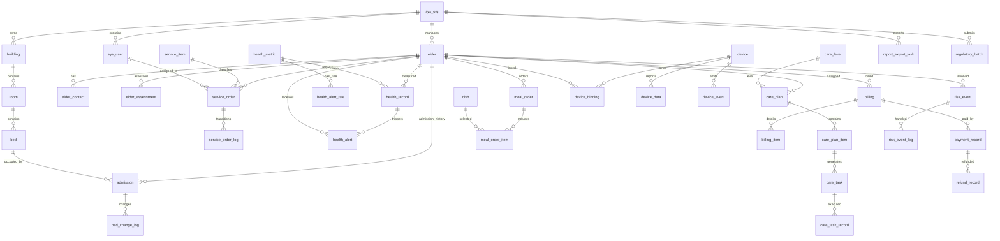

# 智慧养老管理系统 — 数据库 ER 关系设计

## 1. 设计原则
- 数据库：MySQL 8.0 / InnoDB / utf8mb4。
- 业务表采用 BIGINT 自增主键；跨表关联字段统一 BIGINT。
- 机构隔离：核心业务表带 `org_id`。
- 主数据可逻辑删除；账务、工单、健康记录、任务执行、风险事件等流水不做物理删除。
- 金额统一 `DECIMAL(12,2)`；健康指标值使用 `DECIMAL(10,3)`。
- 状态使用 VARCHAR，避免 MySQL ENUM 导致后期扩展困难。
- SQL 中显式建立主要索引；应用层仍需校验机构归属和业务状态。

## 2. ER 图（逻辑关系）

## 3. 表分组与关系说明

### 3.1 系统与组织
- `sys_org` 1:N `sys_user`、老人、楼栋等业务对象。
- `sys_user`、`sys_role`、`sys_permission` 通过用户角色、角色权限中间表关联。
- `sys_operation_log` 记录关键操作。

### 3.2 老人档案与入住空间
- `elder` 是老人主档案。
- `elder_contact`、`elder_assessment` 与老人 1:N。
- `building` 1:N `room`，`room` 1:N `bed`。
- `elder` 1:N `admission`，`bed` 1:N `admission`（历史关系）。
- 同一床位不能存在时间重叠的有效入住记录。MySQL 普通唯一索引无法直接表达时间区间不重叠，必须在事务中锁定床位并校验。

### 3.3 服务、健康与护理
- `service_order` 关联老人、服务项目、创建人和执行人；`service_order_log` 保存状态轨迹。
- `health_record` 关联老人和指标；规则命中后生成 `health_alert`。
- `care_plan` 关联老人和护理等级；`care_plan_item` 定义执行频次；`care_task` 是具体任务实例；`care_task_record` 保存执行结果。

### 3.4 餐饮与财务
- `meal_order` 关联老人；`meal_order_item` 保存菜品快照。
- `billing` 关联老人和入住记录；`billing_item` 保存计费明细快照。
- `payment_record` 关联账单；`refund_record` 关联原收款记录。
- 账单金额、已收金额等冗余汇总字段必须由事务内业务服务维护，并可通过明细重算校验。

### 3.5 IoT 与风险
- `device` 是设备台账；`device_binding` 记录设备与老人/空间的绑定有效期。
- `device_data` 存储采集数据；`device_event` 存储设备事件。
- `risk_event` 是业务风险事件；`risk_event_log` 保存处理轨迹。

### 3.6 报表与监管
- `report_export_task` 保存异步导出任务及文件信息。
- `regulatory_template` 保存报送模板字段配置。
- `regulatory_batch` 保存每次报送批次及结果。

## 4. 关键索引建议
- 老人：`(org_id, elder_no)` 唯一；`(org_id, name)`、`(org_id, id_no_hash)` 查询索引。
- 床位：`(org_id, room_id, bed_no)` 唯一；`(org_id, status)`。
- 入住：`(org_id, elder_id, status)`、`(org_id, bed_id, status)`。
- 工单：`(org_id, status, created_at)`、`(org_id, assignee_id, status)`。
- 健康记录：`(org_id, elder_id, metric_id, measured_at)`。
- 护理任务：`(org_id, assignee_id, task_date, status)`；`(org_id, idempotency_key)` 唯一。
- 账单：`(org_id, elder_id, bill_month)`；收款流水号唯一。
- IoT：`(device_id, collected_at)`、`(org_id, event_status, created_at)`。
- 风险事件：`(org_id, status, severity, occurred_at)`。
- 导出任务：`(org_id, created_by, status, created_at)`。

## 5. 物理模型注意事项
1. 所有外键约束在 SQL 中显式创建；若未来采用分库分表或超大规模时序数据，部分日志/采集表可调整为应用层关联。
2. `org_id` 必须由服务端登录上下文注入，不能信任前端传入值。
3. `id_no` 等敏感字段生产环境建议加密存储；如需精确检索，另存不可逆哈希列并建立索引。
4. 时间范围查询应使用左闭右开区间，例如 `created_at >= start AND created_at < end`。
5. 健康记录、设备数据增长较快，后期按月分区或冷热归档需基于真实数据量评估。
