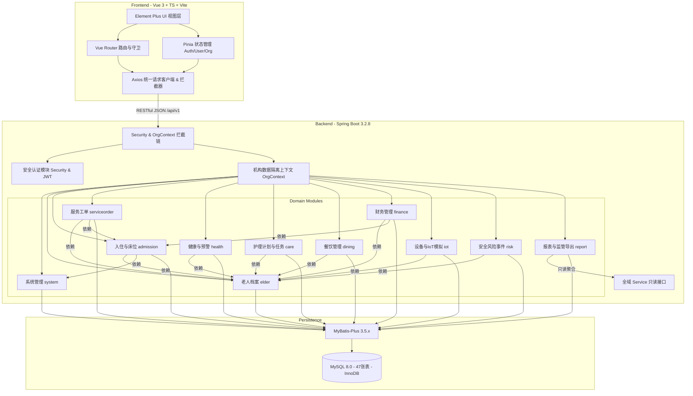

# 智慧养老管理系统 — 系统架构与模块设计文档

- **版本**: V1.0
- **架构模式**: 模块化单体（Modular Monolith）
- **核心技术栈**: Spring Boot 3.2.8 / Java 17 (JDK 21 兼容) + Vue 3 / Vite 5 / TypeScript / Element Plus + MySQL 8.0

---

## 1. 系统总体架构图



---

## 2. 模块分层与依赖规范

### 2.1 模块依赖层级
1. **基础核心层（无业务依赖）**:
   - `com.example.elderlycare.common`: 统一 API 响应结果 `ApiResponse<T>`、业务异常 `BusinessException`、错误码枚举 `ErrorCode`、分页封装 `PageResult<T>`、基础审计字段基类 `BaseEntity`。
   - `com.example.elderlycare.config`: MyBatis-Plus 分页插件、OpenAPI Swagger 配置、Jackson 时区及序列化配置。
   - `com.example.elderlycare.security`: JWT 令牌编解码、Spring Security 过滤链、`UserContext` 与 `OrgContextHolder`。
2. **核心主数据层**:
   - `system`: 机构 `sys_org`、用户 `sys_user`、角色 `sys_role`、权限 `sys_permission`、审计日志 `sys_operation_log`。
   - `elder`: 老人档案 `elder`、紧急联系人 `elder_contact`、能力评估 `elder_assessment`。
   - `admission`: 楼栋 `building`、房间 `room`、床位 `bed`、入住记录 `admission`、床位变更历史 `bed_change_log`。
3. **日常照护与业务流转层**:
   - `serviceorder`: 服务项目 `service_item`、服务工单 `service_order`、工单流转日志 `service_order_log`。
   - `health`: 健康指标 `health_metric`、体征记录 `health_record`、预警规则 `health_alert_rule`、预警处理 `health_alert`。
   - `care`: 护理等级 `care_level`、护理项目 `care_item`、护理计划 `care_plan`、计划明细 `care_plan_item`、任务实例 `care_task`、执行记录 `care_task_record`。
   - `risk`: 安全风险事件 `risk_event`、风险处理轨迹 `risk_event_log`。
4. **后勤与支撑业务层**:
   - `dining`: 菜品 `dish`、每日菜单 `meal_menu`、菜单明细 `meal_menu_item`、订餐订单 `meal_order`、订餐明细 `meal_order_item`。
   - `finance`: 费用科目 `fee_item`、月度账单 `billing`、账单明细 `billing_item`、收款记录 `payment_record`、退款记录 `refund_record`。
   - `iot`: 设备台账 `device`、设备绑定 `device_binding`、采集数据 `device_data`、设备告警 `device_event`。
5. **分析与外部报送层（顶层）**:
   - `report`: 异步报表导出 `report_export_task`、监管报送模板 `regulatory_template`、报送批次 `regulatory_batch`。

### 2.2 跨模块调用红线
- **禁止跨模块直接注入并调用对方 Mapper**：模块 A 如需获取模块 B 的数据，必须通过模块 B 暴露的公开 Service 接口（或只读 QueryService）。
- **禁止循环依赖**：如 A 模块依赖 B 模块，B 模块严禁反向依赖 A 模块。若有双向交互需求，通过领域事件解耦或上提至协调服务。
- **Entity 与 DTO/VO 严格隔离**：外部请求统一接收 DTO 并进行 JSR-303/380 校验，对外响应统一封装 VO，Entity 仅在持久层流转。

---

## 3. 关键机制实现方案

### 3.1 机构数据隔离（Org Data Isolation）
- **上下文注入**: JWT 载荷中包含 `userId`、`username`、`orgId`、`roles`。经过 `JwtAuthenticationFilter` 解析后，写入 `SecurityContextHolder` 和 `OrgContextHolder`（ThreadLocal）。
- **持久层加锁/过滤**:
  - 增：自动填充 `created_by`、`created_at` 以及当前上下文的 `org_id`。
  - 查/改/删：所有查询条件中显式带上 `org_id = #{currentOrgId}`，且通过 ID 操作时必须校验归属机构一致。

### 3.2 床位并发分配与状态机原子性
- **入住与调床流程**:
  1. 开启 `@Transactional(rollbackFor = Exception.class)`。
  2. 执行 `bedMapper.selectByIdForUpdate(bedId)` 锁定床位。
  3. 业务校验：床位状态必须为 `AVAILABLE`，且老人不存在状态为 `ACTIVE` 的入住记录。
  4. 插入 `admission` 记录（状态为 `ACTIVE`）。
  5. 更新 `bed` 状态为 `OCCUPIED`，版本号 `version = version + 1`。
  6. 更新 `elder` 状态为 `IN_HOUSE`。
  7. 插入 `bed_change_log`（类型为 `CHECK_IN` 或 `TRANSFER`）。
  8. 事务提交。任一环节异常全部回滚。

### 3.3 护理任务生成幂等性
- **幂等键设计**: `idempotency_key = {plan_item_id}_{task_date}_{frequency_slot}`。
- **执行保障**:
  - 定时任务批量生成时，计算各老人有效计划项当天应生成的任务列表。
  - 先基于应用层 Redis/内存缓存防重，最终落库由 MySQL 唯一索引 `uk_care_task_idem (org_id, idempotency_key)` 兜底。
  - 若触发唯一键冲突异常，自动忽略重复记录并记录跳过日志，确保调度任务安全幂等重试。

### 3.4 财务账单与收款闭环
- **金额规范**: 数据库统一 `DECIMAL(12,2)`，Java 中全链路采用 `BigDecimal`，禁用 `double`/`float`。
- **核对机制**:
  - `billing.total_amount` 必须严格等于所有子项 `billing_item.amount` 汇总。
  - `billing.paid_amount` 必须严格等于所有状态为 `SUCCESS` 的 `payment_record.amount` 减去所有状态为 `REFUNDED` 的 `refund_record.amount`。
  - 收款请求必须附带 `idempotency_key`（业务防重号），由 `uk_payment_idem` 兜底防重复记账。

---

## 4. 前端工程架构

```text
frontend/
├── index.html
├── package.json
├── tsconfig.json
├── vite.config.ts
└── src/
    ├── main.ts
    ├── App.vue
    ├── api/                    # 集中式 API 请求函数，统一调用 request 封装
    │   ├── auth.ts             # 登录、登出、当前用户信息
    │   ├── system.ts           # 机构、用户、角色、权限
    │   ├── elder.ts            # 老人档案、联系人、评估
    │   ├── admission.ts        # 楼栋、房间、床位、入住、调床、退住
    │   ├── serviceorder.ts     # 服务目录、工单流转
    │   ├── health.ts           # 指标、体征记录、预警
    │   ├── care.ts             # 护理等级、计划、任务
    │   ├── dining.ts           # 菜品、菜单、订餐
    │   ├── finance.ts          # 费用项、账单、收款、退款
    │   ├── iot.ts              # 设备台账、绑定、数据、事件
    │   ├── risk.ts             # 风险事件及处理
    │   └── report.ts           # 报表统计、异步导出、监管
    ├── assets/                 # 样式系统、字体、静态图标
    │   └── styles/
    │       ├── index.scss
    │       ├── variables.scss
    │       └── element-override.scss
    ├── components/             # 通用复用业务组件
    │   ├── DictSelect/         # 字典/下拉枚举选择器
    │   ├── StatusTag/          # 统一状态徽标组件
    │   ├── OrgSelect/          # 机构切换器
    │   ├── PaginationTable/    # 统一分页表格容器
    │   └── ConfirmDialog/      # 高风险操作二次确认弹窗
    ├── layouts/                # 后台基础骨架
    │   ├── default/
    │   │   ├── index.vue
    │   │   ├── Sidebar.vue     # 动态侧边栏导航
    │   │   ├── Navbar.vue      # 顶栏、个人中心、机构切换
    │   │   └── AppMain.vue     # 主内容区域与 Keep-Alive 视图
    ├── router/                 # 路由及权限守卫
    │   ├── index.ts
    │   └── guards.ts           # 登录鉴权拦截、动态路由挂载
    ├── stores/                 # Pinia 响应式状态中心
    │   ├── auth.ts             # Token、登录状态
    │   ├── user.ts             # 个人资料、角色权限标识
    │   └── app.ts              # 侧边栏折叠、全局主题、通知
    ├── utils/
    │   ├── request.ts          # Axios 实例、Token 注入、统一错误拦截
    │   ├── validate.ts         # 常用校验工具（手机号、身份证、金额）
    │   └── format.ts           # 日期时间格式化、金额千分位格式化
    └── views/                  # 13 个业务模块页面
        ├── login/
        ├── dashboard/
        ├── system/
        ├── elder/
        ├── admission/
        ├── serviceorder/
        ├── health/
        ├── care/
        ├── dining/
        ├── finance/
        ├── iot/
        ├── risk/
        └── report/
```
