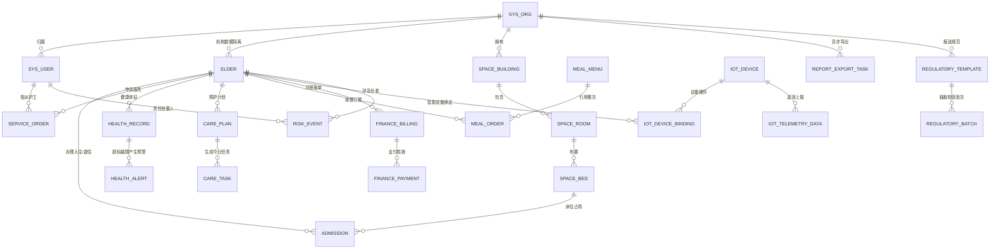

# 智慧养老综合运营管理系统 - 数据库初始化与迁移维护指南

## 一、数据库环境要求

- **数据库版本**：MySQL 8.0.28+ (推荐 MySQL 8.0.32 LTS)
- **存储引擎**：InnoDB（支持行级排他锁、事务 ACID 与外键完整性）
- **默认字符集**：`utf8mb4`
- **排序规则**：`utf8mb4_unicode_ci` / `utf8mb4_0900_ai_ci`
- **默认时区**：`Asia/Shanghai` (`+08:00`)

---

## 二、初始化脚本执行次序

必须严格按照以下顺序执行脚本，避免因外键依赖约束导致执行失败：

```bash
# 1. 登录 MySQL 并创建空数据库
mysql -u root -p -e "CREATE DATABASE IF NOT EXISTS smart_elderly_care DEFAULT CHARACTER SET utf8mb4 COLLATE utf8mb4_unicode_ci;"

# 2. 执行核心数据表结构 DDL (含外键、行级悲观锁注意点与唯一索引)
mysql -u root -p smart_elderly_care < database/schema.sql

# 3. 按阶段顺序灌入种子演示数据 (Seed Data)
mysql -u root -p smart_elderly_care < database/seed/01_system_seed.sql      # 阶段 2: 机构与管理员、护工、主管用户
mysql -u root -p smart_elderly_care < database/seed/02_elder_seed.sql       # 阶段 3: 长者档案与联系人 (含AES密文)
mysql -u root -p smart_elderly_care < database/seed/03_admission_seed.sql   # 阶段 4: 楼栋、房间、床位与入住
mysql -u root -p smart_elderly_care < database/seed/04_service_seed.sql     # 阶段 5: 服务项目与工单状态机
mysql -u root -p smart_elderly_care < database/seed/05_health_seed.sql      # 阶段 6: 体征指标、记录与预警规则
mysql -u root -p smart_elderly_care < database/seed/06_care_seed.sql        # 阶段 7: 护理等级、计划与日任务
mysql -u root -p smart_elderly_care < database/seed/07_risk_seed.sql        # 阶段 8: 安全隐患事件闭环
mysql -u root -p smart_elderly_care < database/seed/08_dining_seed.sql      # 阶段 9: 菜品、菜单与订餐快照
mysql -u root -p smart_elderly_care < database/seed/09_finance_seed.sql     # 阶段 10: 费用项目、账单与支付幂等
mysql -u root -p smart_elderly_care < database/seed/10_iot_seed.sql         # 阶段 11: 设备台账、绑定与遥测
mysql -u root -p smart_elderly_care < database/seed/11_report_seed.sql      # 阶段 12: 异步报表导出任务
mysql -u root -p smart_elderly_care < database/seed/12_regulatory_seed.sql  # 阶段 13: 监管报送模板与校验批次
```

---

## 三、核心数据表 ER 关系图



---

## 四、核心数据表清单一览

| 模块 | 数据表名 | 中文说明 | 关键约束与设计考量 |
| :--- | :--- | :--- | :--- |
| **系统底座** | `sys_org` | 养老机构表 | 租户根实体，机构编码唯一约束 |
| | `sys_user` | 用户与账号 | `username` 唯一，密码 BCrypt 散列 |
| | `sys_role` / `sys_user_role` | RBAC 角色体系 | `ORG_ADMIN`, `NURSE_DIRECTOR`, `CAREGIVER` |
| | `sys_operation_log` | 审计操作日志 | 关键业务变更与登录轨迹记录 |
| **长者档案** | `elder` | 长者主档案 | 身份证 AES 密文存储，SHA-256 辅助索引 |
| | `elder_contact` | 紧急联系人 | 标识主联系人与紧急联系人 |
| | `elder_assessment` | 能力评估记录 | 评估自理等级（自理/半自理/失能） |
| **入住床位** | `space_building` | 物理楼栋 | 楼栋编号唯一 |
| | `space_room` | 房间档案 | 房间类型与楼层关联 |
| | `space_bed` | 床位资产 | 状态（`VACANT`, `OCCUPIED`），支持行锁 |
| | `admission` | 入住与退住流转 | 一个老人同一时刻只能有一条 `CHECKED_IN` |
| | `bed_change_log` | 转床操作履历 | 记录原床位、新床位与审批操作人 |
| **服务工单** | `service_item` | 照料服务项目 | 收费标准与服务时长 |
| | `service_order` | 服务工单台账 | 状态机（待派/进行中/待确认/已归档/取消） |
| | `service_order_log` | 工单轨迹日志 | 记录工单流转节点与处理人 |
| **健康预警** | `health_metric` | 生命体征指标 | 血压、心率、血糖、血氧编码定义 |
| | `health_record` | 体征测量记录 | 记录测量时间、数值与采录人 |
| | `health_alert_rule` | 预警阈值规则 | 支持上下限阈值与不同报警等级 |
| | `health_alert` | 健康预警台账 | 状态（待处理/已处理/已忽略），防抖去重 |
| **照料护理** | `care_level` | 照护等级字典 | 设定服务频次与基础费用 |
| | `care_plan` | 个性化照护计划 | 关联长者与日常执行周期 |
| | `care_task` | 护理执行日任务 | 幂等任务单，状态（待执行/已完成/跳过） |
| | `care_task_record` | 护理履约留痕 | 记录执行护工、签到时间与长者反馈 |
| **餐饮管理** | `meal_dish` | 菜品信息库 | 菜品名称、单价、过敏源与适用人群 |
| | `meal_menu` | 每日餐次菜单 | 按早中晚餐排期并发布菜单 |
| | `meal_order` | 就餐订单 | 订单主表与送餐房间 |
| | `meal_order_item` | 订单菜品明细 | **固化菜品名称与下单单价快照** |
| **财务管理** | `finance_fee_item` | 收费项目字典 | 床位费、护理费、伙食费、水电费 |
| | `finance_billing` | 费用对账账单 | 汇总总金额与已缴金额，核对一致 |
| | `finance_billing_item` | 账单计费明细 | **计费周期与价格快照** |
| | `finance_payment` | 缴费收款流水 | **幂等键防重 (`idempotent_key`)**，不可物理删除 |
| | `finance_refund` | 退款退费审批 | 严格限制退款上限不超原收款可退金额 |
| **设备物联** | `iot_device` | 物联设备档案 | 设备编码、类型（手表/床垫/SOS等） |
| | `iot_device_binding` | 老人/空间绑定 | 设备绑定历史跟踪 |
| | `iot_telemetry_data` | 设备遥测流水 | 原始值、标准化值与采集时钟 |
| | `iot_device_event` | 设备异常事件 | 离线报警、低电量、SOS 触发记录 |
| **安全风险** | `risk_event` | 安全隐患事件 | 跌倒、走失、火警；待派/处置中/已关闭 |
| | `risk_event_log` | 风险处置留痕 | 应急响应措施与闭环验收人 |
| **数据报表** | `report_export_task` | 异步导出任务 | 状态（排队/处理中/成功/失败），7天有效期 |
| **监管报送** | `regulatory_template`| 报送规范模板 | 存储目标部门、业务域与字段映射 JSON |
| | `regulatory_batch` | 监管报送批次 | 校验结果 JSON，回执单号与受理记录 |
