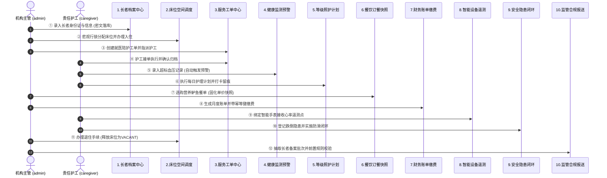

# 智慧养老综合运营管理系统 - 本地启动与端到端演示指南

## 一、环境准备要求

运行和编译本项目前，请确保本地开发机器满足以下基础环境：
- **JDK**：OpenJDK 17 LTS 或 Oracle JDK 17+
- **构建工具**：Apache Maven 3.8+
- **Node.js**：Node 18.x 或 Node 20.x+ (带 npm 9+)
- **数据库**：MySQL 8.0.x (需预先执行 `database/schema.sql` 和 `database/seed/` 种子脚本)

---

## 二、本地快速启动步骤

### 2.1 启动后端工程 (`backend`)

1. **配置文件确认**：
   检查 `backend/src/main/resources/application.yml` 中的数据库连接信息：
   ```yaml
   spring:
     datasource:
       url: jdbc:mysql://localhost:3306/smart_elderly_care?useUnicode=true&characterEncoding=utf8&serverTimezone=Asia/Shanghai
       username: root
       password: your_mysql_password
   ```

2. **命令行运行启动**：
   ```bash
   cd backend
   mvn spring-boot:run
   ```
   后端服务启动成功后，默认监听在 **`http://localhost:8080`**。
   - OpenAPI / Swagger 接口文档：`http://localhost:8080/swagger-ui/index.html`
   - 健康检查端点：`http://localhost:8080/api/v1/health`

### 2.2 启动前端工程 (`frontend`)

1. **进入前端目录并启动开发服务**：
   ```bash
   cd frontend
   npm run dev
   ```
2. 开发服务器启动完成后，浏览器访问 **`http://localhost:5173`** 即可进入系统登录页面。

---

## 三、预置测试机构与演示账号清单

> [!NOTE]
> 为便于本地开发评估与功能验收，系统预置了完整的测试账号矩阵。所有测试账号初始密码统一为 `123456`。

| 用户名 (登录账号) | 密码 | 机构名称 | 所属角色 | 职能说明与核心操作权限 |
| :--- | :--- | :--- | :--- | :--- |
| **`admin`** | `123456` | 幸福养老院（总院） | 机构管理员 (`ORG_ADMIN`) | 机构全权限：入住审批、费用管理、用户角色、系统设置、监管报送提交 |
| **`director`** | `123456` | 幸福养老院（总院） | 护理主管 (`NURSE_DIRECTOR`)| 照料主管：护理等级与计划编排、工单分配审核、健康预警处置、餐饮菜单维护 |
| **`caregiver`** | `123456` | 幸福养老院（总院） | 一线护工 (`CAREGIVER`) | 移动执行：每日护理任务打卡履约、体征数据上报、工单接单与执行 |
| **`sh_admin`** | `123456` | 颐养健康中心（分院） | 机构管理员 (`ORG_ADMIN`) | **用于验证跨机构多租户隔离**：无法查看总院的长者、床位、账单或报表 |

---

## 四、端到端 (E2E) 业务闭环 10 步演示指南

以下演示脚本覆盖长者在机构内的**完整生命周期**，可在演示汇报中按步骤操作并展示对应业务价值：



### 1. 登录与全景运营工作台 (`/dashboard`)
- 使用 `admin` / `123456` 登录；
- 进入「运营工作台」，直观查看在住长者总数、床位占用率、今日待派工单、今日护理完成率、待处置健康预警、当月财务收款、安全隐患事件及 IoT 遥测点等 8 项核心运营 KPI；
- 查看近 7 日长者入住/退住流转对比柱状图与护理任务履约趋势图。

### 2. 长者建档与敏感信息加密 (`/elder`)
- 点击侧边栏「老人档案」，点击「新增老人」；
- 录入长者姓名、18 位身份证号码、联系方式、慢性病史与膳食禁忌（如高血压、低盐低脂饮食）；
- **验收点**：列表中身份证显示为脱敏格式（如 `110101********1234`）；数据库实际存储为 AES 密文与哈希索引，无明文泄露。

### 3. 空间床位分配与入住占床 (`/admission`)
- 点击侧边栏「入住与床位」；
- 查看空闲床位分布，点击「办理入住」，选择刚刚录入的长者与目标床位；
- 确认入住时间、护理等级与月度床位基准费用；
- **验收点**：床位状态由 `VACANT`（空闲）实时变为 `OCCUPIED`（占用）；再次尝试向该床位办理入住将被排他行锁与业务校验拦截拒绝。

### 4. 服务工单流转与闭环 (`/serviceorder`)
- 点击侧边栏「服务工单」，点击「发起工单」；
- 选择服务长者与项目（如：常规就医陪护），提交派单；
- 点击「指派护工」分配给一线护理员；
- 切换状态完成接单（`IN_PROGRESS`） $\to$ 执行完成（`COMPLETED`） $\to$ 满意度确认并归档（`CONFIRMED`）；
- 点击工单详情可查看完整流转操作轨迹日志。

### 5. 生命体征采集与预警触发 (`/health`)
- 点击「健康管理」；
- 为在住长者新增一条收缩压为 `165 mmHg` 的体征记录（超过 140 阈值）；
- **验收点**：系统自动命中高血压超标预警规则，并在「待处理健康预警」生成一条高危报警；
- 责任医护人员点击「处置」，填写干预措施并解除预警。

### 6. 等级照护日任务履约 (`/care`)
- 点击「护理管理」；
- 查看为长者生成的个性化护理计划；
- 点击「今日护理任务」，护工点击「打卡执行」，录入长者反馈并保存执行留痕；
- 返回工作台大屏，可观察到“今日护理完成率”动态提升。

### 7. 餐饮选餐与价格快照验证 (`/dining`)
- 点击「餐饮管理」，查看每日营养餐单；
- 为长者录入午餐订餐订单，系统显著高亮提示其过敏源与禁忌（低盐低脂）；
- 提交订单后，查看订单明细中的单价与菜品名称；
- **验收点**：即使后续菜品库中的鲈鱼调价或下架，该历史订餐订单明细的单价与金额快照保持恒定。

### 8. 财务账单生成与支付幂等 (`/finance`)
- 点击「财务管理」；
- 针对长者出账月度综合费用账单（包含床位费、照护费、餐饮费）；
- 点击「收款缴费」，录入收款方式与金额，系统自动生成幂等防重号；
- **验收点**：重复提交缴费请求不会重复扣款，账单状态精确更新为 `PAID`。

### 9. 物联设备绑定与数据采集 (`/iot`)
- 点击「设备物联」；
- 为长者绑定智能穿戴手表或智能睡眠床垫；
- 点击「模拟上报测试」，上报一条实时心率与定位遥测数据；
- 在设备详情页可查看实时波动的遥测点流水与设备在线状态。

### 10. 长者退住与床位安全释放 (`/admission`)
- 进入「入住与床位」列表，在在住长者行点击「办理退住」；
- 确认结算离院时间与退住原因；
- **验收点**：长者档案状态转为 `DISCHARGED`；原占用的床位自动释放恢复为 `VACANT`（空闲），可被后续新入住长者重新分配。

### 11. 综合报表中心与异步流式导出 (`/report`)
- 点击「统计报表」，进入业务综合报表中心；
- 自由切换 8 类报表（入住退住、床位、工单、护理、健康、账单、设备、安全风险），查看动态表头与多维过滤；
- 点击「提交异步导出任务」，输入自定义文件名并提交；
- 切换至「异步导出任务中心」，查看后台生成的任务单号与流式导出文件，点击「下载 CSV」可在本地无乱码打开。

### 12. 监管报送模板与前置合规校验 (`/regulatory`)
- 点击「监管报送」；
- 在「监管报送模板」中查看民政长者、床位、卫健照护与应急安全 4 套模板的字段映射规则；
- 点击「生成报送批次」，系统自动抽取长者数据并执行 18 位身份证及必填合规校验；
- 点击「校验报告」抽屉，查看精准定位到行号、字段名与整改原因的校验报告；
- 点击「登记提交」，通过预留 Adapter 记录外部回执单号与提交通道。
