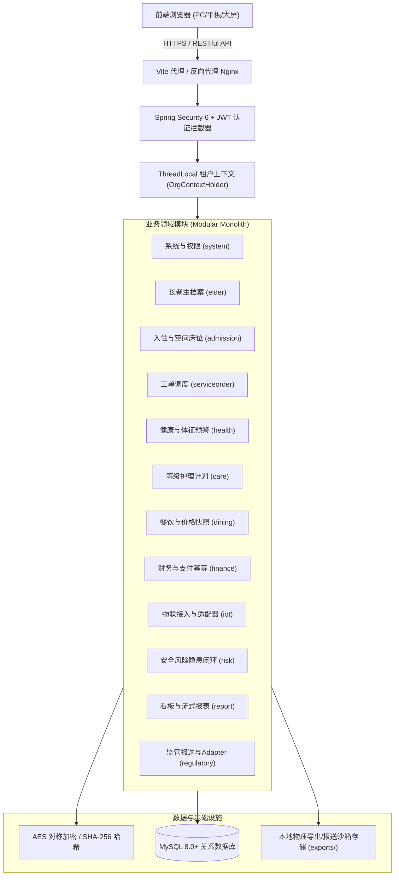

# 智慧养老综合运营管理系统 - 系统架构与核心技术设计规范

## 一、系统总体设计与技术架构

本项目定位为**面向多机构、高可用、高合规的智慧养老综合运营管理平台**，采用**模块化单体（Modular Monolith）**架构设计。既保证了单体部署与运维的轻量低成本，又实现了清晰的业务领域边界隔离，为未来按需微服务化演进提供了平滑迁移路径。

### 1.1 技术技术栈选型

| 层次 | 核心技术选型 | 选用版本 / 规范 | 选型优势与设计考量 |
| :--- | :--- | :--- | :--- |
| **基础运行环境** | OpenJDK 17 LTS / Node.js 18+ | Java 17 | 现代语法特性、高吞吐 G1/ZGC 垃圾回收支持 |
| **后端框架** | Spring Boot | 3.3.1 | 自动装配、原生 GraalVM 兼容性、Spring Security 6 |
| **数据持久层** | MyBatis-Plus + HikariCP | 3.5.7 | 防 SQL 注入、Lambda 类型安全查询、高性能连接池 |
| **关系型数据库** | MySQL 8.0+ | InnoDB (utf8mb4) | 行级悲观排他锁、JSON 原生字段支持、外键与完整性约束 |
| **安全与认证** | Spring Security 6 + JWT | JJWT 0.12.5 | 无状态 RBAC 授权、BCrypt 密码单向哈希 |
| **前端工程** | Vue 3 + TypeScript + Vite | Vue 3.4 / TS 5.5 | Composition API、强类型约束、秒级热更新构建 |
| **UI 组件库** | Element Plus | 2.7.7 | 医疗养老风格深色侧边栏、卡片化布局、丰富的交互状态 |
| **状态管理** | Pinia | 2.1.7 | 轻量无冗余全局租户与认证状态管理 |

### 1.2 系统架构拓扑图



---

## 二、核心机制与安全方案

### 2.1 机构多租户数据隔离机制
- **隔离级别**：全系统严格遵循**共享数据库、共享数据表、机构ID租户强隔离**标准。
- **上下文注入**：请求进入 `JwtAuthenticationFilter` 时，自动解析 JWT Claims 中的 `orgId`，写入基于 `ThreadLocal` 的 `OrgContextHolder`。
- **业务查询与变更拦截**：
  - 所有 Mapper 查询与变更统一添加 `eq(Entity::getOrgId, currentOrgId)` 条件；
  - 在涉及根据主键 ID 修改、删除、下载导出文件、查看批次详情时，强制执行 `if (!entity.getOrgId().equals(currentOrgId)) throw new BusinessException("无权跨机构访问");`，阻断越权数据渗透。

### 2.2 敏感数据保护与合规脱敏
1. **密码存储**：
   - 用户密码强制使用 `BCryptPasswordEncoder` 散列存储（加盐计算，不可逆反解）。
2. **公民身份证号加密存储与等值检索**：
   - 身份证明文严禁直接落库，采用 **AES-128 (ECB/PKCS5Padding)** 对称加密存储于 `id_no_ciphertext`；
   - 为避免全量密文解密造成的全表扫描性能损耗，配套生成不可逆 **SHA-256 哈希索引** 存储于 `id_no_hash`，实现等值精准快速检索。
3. **数据展示脱敏**：
   - 身份证号前端展示脱敏规则：`110101********1234`（保留前 6 位与后 4 位）；
   - 手机号脱敏规则：`138****5678`；
   - 生产环境审计日志严禁打印未脱敏的公民身份证明文与银行卡号。

### 2.3 悲观行锁并发占床与入住状态一致性控制
- **业务痛点**：多操作员并发为老人选床、转床时，若仅在应用内存判断空闲状态，极易出现高并发下“两人占用同一床位”的数据冲突。
- **解决方案**：
  ```sql
  -- 办理入住或转床前，在事务内显式执行行级排他悲观锁
  SELECT * FROM space_bed WHERE id = #{bedId} FOR UPDATE;
  ```
  - 校验 `bed.status == 'VACANT'`，若已占用立即回滚抛出 `BED_ALREADY_OCCUPIED`；
  - 校验长者状态，确保长者在当前机构下同一时刻只能拥有唯一处于 `CHECKED_IN` 的有效入住记录；
  - 在同一事务内更新床位为 `OCCUPIED`、插入入住记录、更新长者状态，保障原子性与强一致性。

### 2.4 财务支付幂等与明细快照机制
1. **幂等流水防重复入账**：
   - 收款登记传入业务端幂等唯一号 `idempotent_key`；
   - `finance_payment` 表建立 `UNIQUE KEY uk_payment_idempotent (org_id, idempotent_key)` 唯一约束；
   - 即使网络抖动客户端发起重复请求，直接捕获重复异常并返回已成功流水，防止机构财务虚增重复扣款。
2. **价格与菜品快照**：
   - 餐饮订单明细 (`meal_order_item`) 固化下单瞬间的菜品名称、单价及金额快照；
   - 账单明细 (`finance_billing_item`) 固化计费期间与费用项目快照，后续菜品调价或项目停用均不影响历史对账凭据。

### 2.5 大数据量报表流式导出与防止 JVM 堆内存溢出 (OOM)
- **风险防范**：传统导出一次性加载几十万行记录进入 JVM，极易导致堆内存峰值瞬间拉爆触发 FullGC 乃至 OOM 崩溃。
- **流式分批机制**：
  - 后台任务采用 **200 条/批次游标流式分页拉取**；
  - 通过 `BufferedWriter` 边查边向磁盘文件刷新写入，不保留对象引用；
  - 输出文件开头写入 `\ufeff` (UTF-8 BOM 头)，确保在 Windows Microsoft Excel 打开时汉字不乱码；
  - 导出文件保留 7 天，下载时强制校验机构属主与文件未过期。

### 2.6 预留监管报送外部 Adapter 契约与解耦规范
- **设计契约**：定义 `RegulatorySubmissionAdapter` 接口，提供 `DefaultFileExportSubmissionAdapter` 默认实现。
- **规范声明**：本系统遵循政务数据报送解耦原则，已完成本地数据抽取、18位身份证格式与必填规则前置校验、合规文件打包与受理回执单号登记。**未收到民政、卫健官方真实网络接口与专网凭证授权前，不宣称已直连政务外网**。
